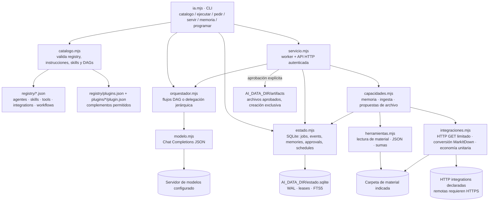

# Arquitectura actual

Este documento describe el código que existe en `AI/src` y `AI/ia.mjs`. La cola persistente y el servidor HTTP están implementados como módulos y comandos; su disponibilidad 24/7 depende de ejecutar y supervisar el proceso en el host. No se ha verificado un despliegue o reinicio real en Ubuntu.

## Persistencia y recuperación

`src/estado.mjs` abre `AI_DATA_DIR/estado.sqlite` con el módulo incorporado `node:sqlite`; crea el directorio con permisos de propietario y activa WAL, claves foráneas y timeout SQLite. El esquema v2 conserva los datos de v1 y añade historial de memoria. Las tablas principales son:

- `jobs`: payload canónico, clave idempotente opcional, estados, resultado/error, intentos y lease con token y vencimiento. Un payload distinto con la misma clave causa conflicto.
- `events`: pasos de agente y eventos asociados a cada job.
- `memories` y `memories_fts`: notas con clave, fuente, tipo, fecha y búsqueda FTS5 por términos.
- `approvals`: propuesta, argumentos y estado `pending` / `approved` / `rejected` / `applied`.
- `schedules`: objetivo, flujo, intervalo y próxima fecha; al activarse crea jobs con clave idempotente por vencimiento.

`tomarTrabajo()` reclama un job en una transacción inmediata y fija lease. Si el worker no renueva el lease, otra instancia puede volver a reclamarlo; tras tres intentos expirados se marca fallido. `servicio.mjs` renueva cada 30 segundos mientras procesa. Esto permite reanudar trabajo de cola, pero no conserva el estado interno de cada llamada al modelo: un job recuperado puede volver a ejecutar agentes y herramientas. Por eso las herramientas externas de escritura no se consideran seguras para reintento automático. El API/estado actual no proporciona cancelación de un job individual.

La memoria puede guardarse, buscarse, listarse y olvidarse por CLI; el API lista, busca y añade preferencias. El worker consulta hasta ocho preferencias y cinco coincidencias FTS. Deduplica por clave y selecciona un pasaje pertinente con su fuente y fecha. La búsqueda es textual; no hay embeddings ni recuperación semántica.

## Servicio y aprobaciones

`ia.mjs servir` requiere `LLM_MODEL`, inicia el worker en el mismo proceso que el HTTP server y escucha por defecto en `127.0.0.1:8787`. Requiere `AI_API_TOKEN` de al menos 32 bytes. Todas las rutas comprueban `Authorization: Bearer …`; también hay límites de tamaño, tiempo de petición y tamaño de cabecera. La API ofrece:

| Método | Ruta | Acción |
| --- | --- | --- |
| GET | `/health` | Responde `{ok:true}` tras autenticación. |
| GET/POST | `/jobs` | Lista jobs o crea uno (202); admite clave de idempotencia. |
| GET | `/jobs/:id` | Detalle y eventos, sin devolver el token del lease. |
| GET | `/approvals` | Lista propuestas. |
| POST | `/approvals/:sha256` | Aprueba y aplica una propuesta de archivo o la rechaza. |
| GET/POST | `/memory` | Lista/busca o registra una preferencia del usuario. |
| GET/POST | `/schedules` | Consulta o crea/reemplaza una programación por intervalo. |

`src/capacidades.mjs` conecta las herramientas de lectura/cálculo con memoria, integración y propuestas. `proponer_archivo` solo acepta un nombre simple, sin carpetas, con extensión `.md`, `.txt`, `.json` o `.csv`, y contenido de hasta 64 KiB. Aplicar una aprobación escribe de forma exclusiva bajo `artifacts/`; un archivo existente con contenido diferente no se sobrescribe. La propuesta pasa a aprobada antes de escribir; una interrupción en ese intervalo puede requerir reintento manual. Los permisos del API token equivalen a acceso a todas las rutas expuestas; no hay identidad por rol ni control por usuario. El endpoint de aprobación invoca aplicación directamente al recibir `approve`, así que debe exponerse solo a quien pueda autorizar esos artefactos.

## Integraciones

`src/integraciones.mjs` implementa consultas HTTP GET con rutas restringidas del manifiesto, sin redirecciones, límite de respuesta de 128 KiB, timeout y requisito HTTPS para hosts remotos. `consultar_integracion` no crea ni modifica datos externos. Para MCP, `src/mcp.mjs` inicia un ejecutable local por stdio sin shell, con `AI_MCP_EXECUTABLE` absoluto y URI de recurso elegida por alias declarado; negocia `initialize`, notifica que terminó la inicialización y solicita `resources/read`, valida la respuesta de texto y corta el proceso al terminar. No llama herramientas MCP ni acepta que el modelo suministre una URI libre. La conexión requiere habilitar/configurar el manifiesto y el ejecutable local. `convertir_documento` usa MarkItDown para los documentos y Tesseract con el idioma español para OCR de imágenes PNG y JPEG. Ambos adaptadores se instalan en el host cuando se necesitan. `economia_unitaria` invoca el script local de Founder Skill con un objeto `datos` y JSON temporal. Las credenciales dependen de variables configuradas; las integraciones HTTP apagadas no demuestran autenticación.

`registry/plugins.json` incluye `revision-documental`, cuyo `plugin.json` agrega un flujo para investigador y revisor. Este complemento es configuración local, no descarga código ni concede acceso adicional.

## Alcance operativo

El worker hace polling en el mismo proceso y activa programaciones vencidas cada iteración. El repositorio incluye una unidad de usuario `deploy/ai.service` con `Restart=on-failure`; la unidad no se instaló ni se verificó en un HP Ubuntu durante esta revisión. Disponibilidad continua también depende de Node, configuración, credenciales y modelo. `SIGINT`/`SIGTERM` abortan el trabajo activo y el lease vencido permite reintentar después; no hay checkpoint de cada subtarea. El código HTTP escucha por defecto en loopback; cambiar `AI_HOST` requiere proteger la red y el secreto fuera del proceso.
